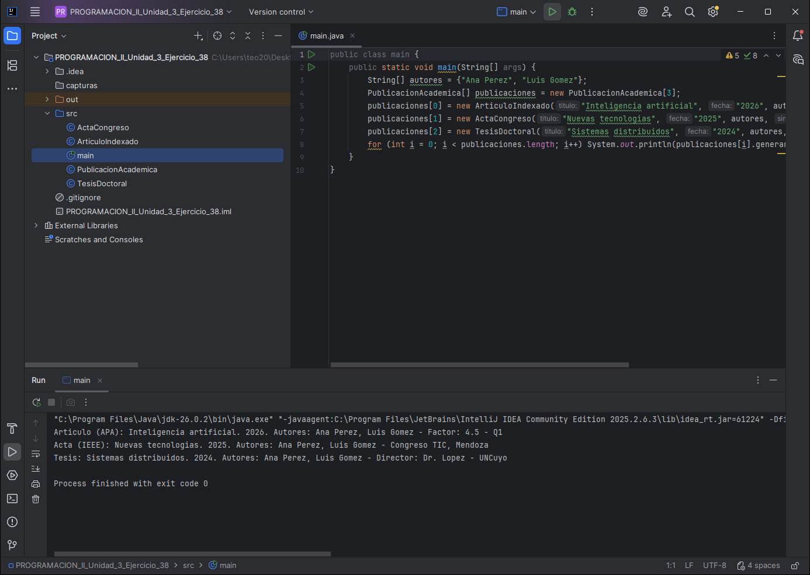

# PROGRAMACIÓN II — Unidad 3, Ejercicio 38: Sistema de Publicaciones y Revistas Científicas

Trabajo práctico de Programación II. Este repositorio contiene la resolución en Java del ejercicio 38 de la Unidad 3.

## Consigna

#### Contexto

Las editoriales académicas administran documentos de divulgación que comparten metadatos esenciales como título, autores, fecha de publicación y número de páginas. No obstante, los artículos de investigación indexados, las actas de congresos internacionales y las tesis doctorales poseen exigencias de revisión por pares y arbitraje institucional completamente diferenciadas.

#### Consigna

Modelar una jerarquía de clases en Java aplicando herencia para estructurar una publicación académica base y sus variantes especializadas en formato digital o impreso.

#### Desarrollo requerido

- Definir la clase base PublicacionAcademica con atributos comunes como titulo, fechaPublicacion y una lista de autores, además de un método de validación de indexación.
- Crear clases hijas como ArticuloIndexado (con factor de impacto de la revista y cuartil), ActaCongreso (con nombre del simposio y ciudad sede) y TesisDoctoral (con nombre del director y universidad otorgante).
- Sobrescribir el método de citación bibliográfica en las subclases para generar el formato de texto correspondiente (APA o IEEE).
- En el método main, instanciar publicaciones de distinta naturaleza, invocar la generación de referencias bibliográficas y mostrar el resultado por consola.

## Estructura del repositorio

```
PROGRAMACION_II_Unidad_3_Ejercicio_38/
├── README.md
├── capturas/
│   └── consola.png
└── src/
    ├── ActaCongreso.java
    ├── ArticuloIndexado.java
    ├── main.java   # clase con el método main
    ├── PublicacionAcademica.java
    └── TesisDoctoral.java
```

## Funcionamiento y lógica

El ejercicio aplica **herencia y sobrescritura** para generar citas bibliográficas de distintos tipos de publicación académica.

### `PublicacionAcademica` (clase base)

Tiene `titulo`, `fechaPublicacion` y un arreglo de `autores` (`protected`). Su método `generarCitacion()` arma un texto con el título, la fecha y los autores: los recorre con un `for` y los separa con comas, sin agregar coma después del último.

### Subclases

Cada una sobrescribe `generarCitacion()`: agrega un prefijo, reutiliza la cita base con `super.generarCitacion()` y suma sus propios datos.

- **`ArticuloIndexado`:** formato "Articulo (APA)", con factor de impacto y cuartil.
- **`ActaCongreso`:** formato "Acta (IEEE)", con el simposio y la ciudad.
- **`TesisDoctoral`:** formato "Tesis", con el director y la universidad.

### `main`

Con los mismos autores (Ana Perez y Luis Gomez), crea un artículo, un acta y una tesis en un arreglo `PublicacionAcademica[]`, y muestra la cita de cada uno con su propio formato.

## Ejecución

Captura de la consola de IntelliJ IDEA ejecutando el programa:



Salida obtenida:

```
Articulo (APA): Inteligencia artificial. 2026. Autores: Ana Perez, Luis Gomez - Factor: 4.5 - Q1
Acta (IEEE): Nuevas tecnologias. 2025. Autores: Ana Perez, Luis Gomez - Congreso TIC, Mendoza
Tesis: Sistemas distribuidos. 2024. Autores: Ana Perez, Luis Gomez - Director: Dr. Lopez - UNCuyo
```
